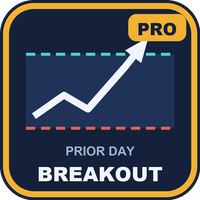
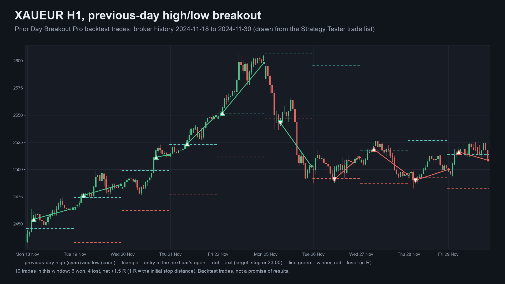
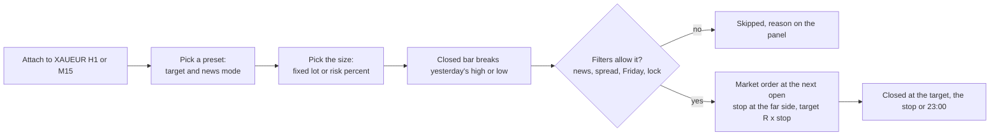
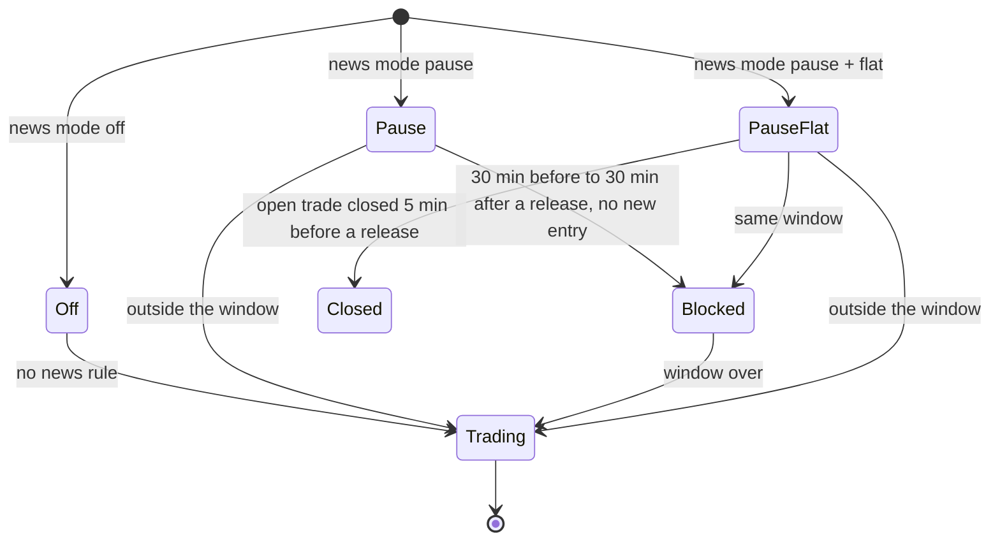
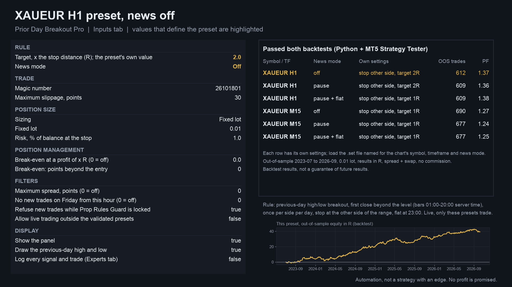
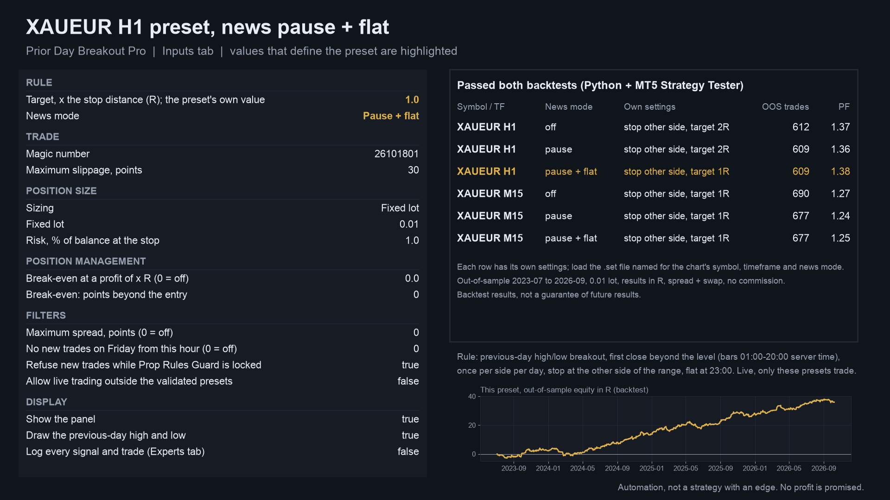
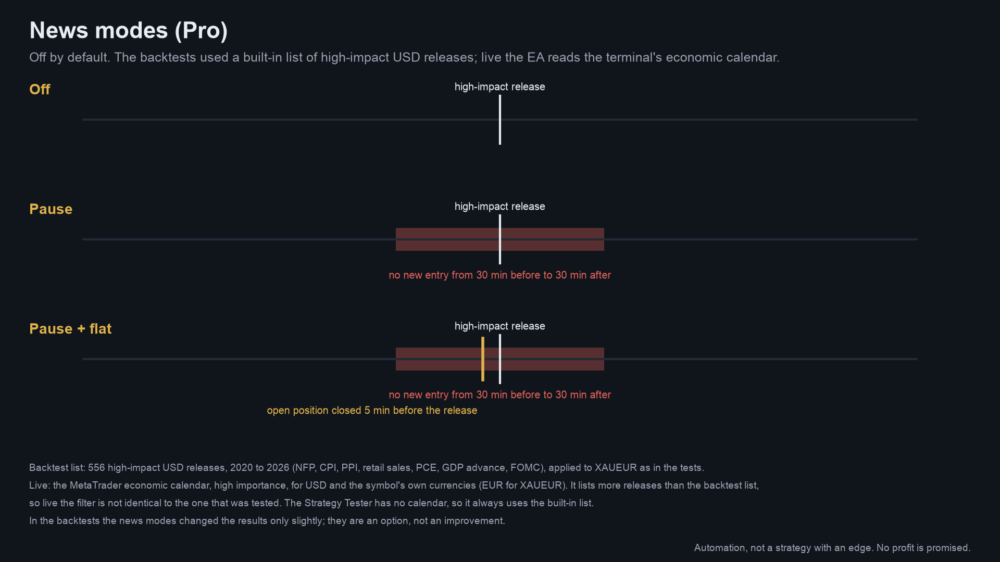
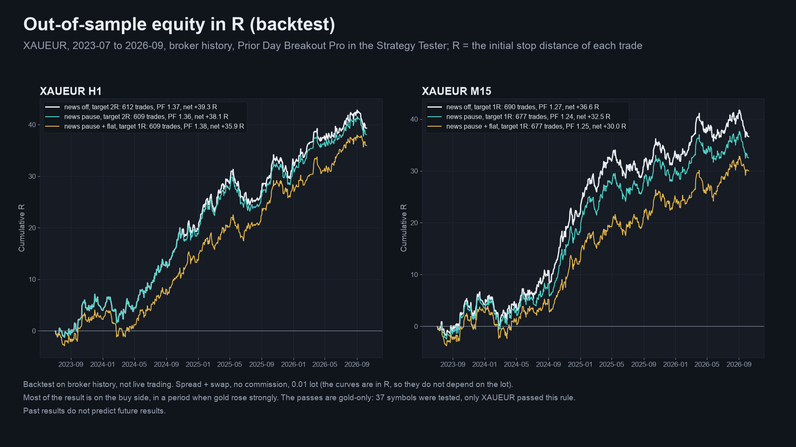
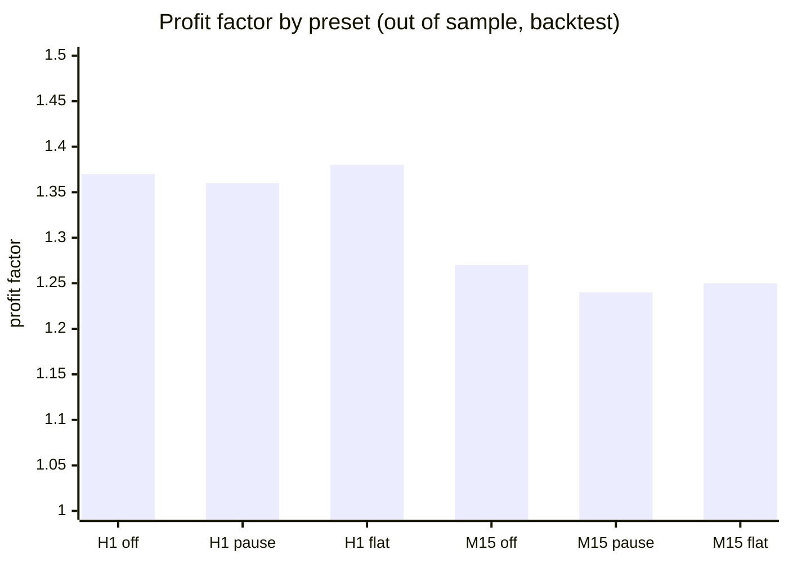
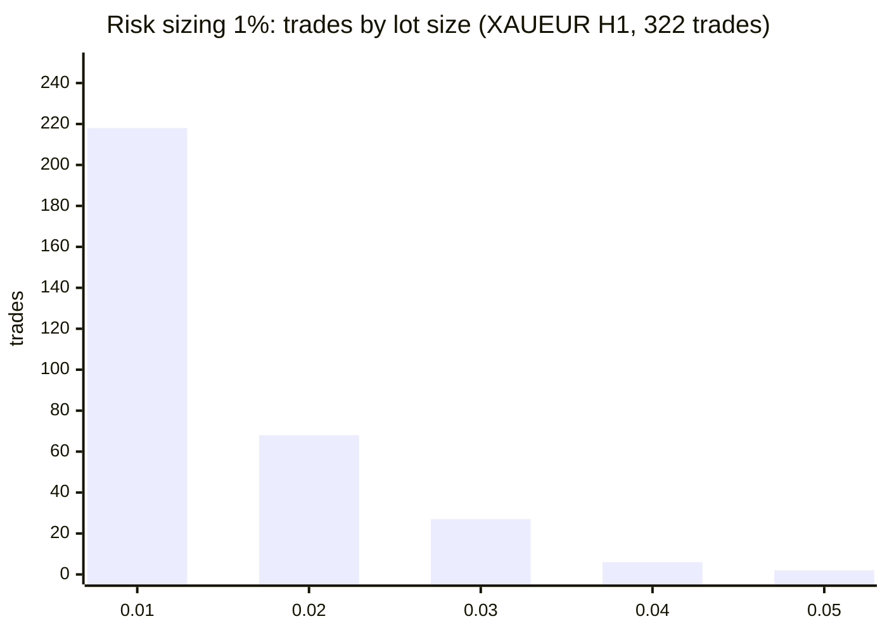

# Prior Day Breakout Pro (MetaTrader 5 and MetaTrader 4)

An Expert Advisor that trades the **previous-day high/low breakout** on **XAUEUR** with a choice of lot sizing, news modes,
spread and Friday filters, and break-even. Six tested presets are included. The backtest evidence is **thin** and is stated as
such below.

> **This is a showcase repository: documentation and images only. There is no source code here.** The product is sold on
> the MQL5 Market. The free edition, with the same rule at a fixed 0.01 lot, has public source:
> [allanninal/prior-day-breakout](https://github.com/allanninal/prior-day-breakout).

**Website:** [allanninal.dev/mql5 (Expert Advisors)](https://www.allanninal.dev/mql5/#eas) · [MT4 editions](https://www.allanninal.dev/mql5/#mt4) · [allanninal.dev](https://www.allanninal.dev)
· **Contact:** message me on [LinkedIn](https://www.linkedin.com/in/allanninal/).

> This EA promises no profit. Every result here is a backtest on broker history, not live trading.

## Get it on the MQL5 Market

| Product | Platform | Price | Link |
|---|---|---|---|
| **Prior Day Breakout Pro** | MT5 | paid | <https://www.mql5.com/en/market/product/201963> |
| **Prior Day Breakout Pro MT4** | MT4 | paid | MT4 edition: coming soon on the MQL5 Market |
| Prior Day Breakout (source on GitHub) | MT5 | free | <https://www.mql5.com/en/market/product/201959> |
| Prior Day Breakout MT4 (source on GitHub) | MT4 | free | MT4 edition: coming soon on the MQL5 Market |

The Pro edition is standalone: you do not need to install the free one. Details, current price and the Strategy Tester demo
are on the Market pages.

## What it does

- **The rule:** levels are the high and low of the previous trading day. A buy needs a closed bar above the high, a sell a closed
  bar below the low, among bars opening 01:00 to 20:00 server time, once per side per day. The EA sends a market order at the
  next bar's open, with the stop at the other side of yesterday's range and a target at a fixed multiple of that distance (R).
  Any open trade is closed at 23:00 server time. One position at a time. A trade is skipped if its stop is under eight times
  the spread.
- **Six validated presets** on XAUEUR, H1 and M15, each with its own target and news mode. Live, the EA trades only these; on any
  other symbol, timeframe, target or news mode it says "not validated" and sends no orders (an input can allow other settings;
  it is off by default). The Strategy Tester accepts any symbol.
- **What Pro adds over the free edition:** lot sizing (a fixed lot, or a risk percent of balance lost if the stop is hit, never
  below the broker minimum; live, a trade is skipped if even the minimum lot risks more than asked), news modes (off, pause,
  pause + flat), a maximum spread and a Friday cut-off hour, break-even at x R, and an optional lock that follows Prop Rules
  Guard MT5.
- **News modes**, off by default: pause blocks new entries from 30 minutes before to 30 minutes after a high-impact release;
  pause + flat also closes an open trade 5 minutes before it. The backtests used a built-in list of 556 high-impact USD
  releases from 2020 to 2026; live the EA reads the terminal's economic calendar, so live the filter is not identical to the
  tested one. In the backtests the news modes changed results only slightly.
- **Closed bars only:** signals do not change after a bar closes, so there is no repaint.

### Presets and what each news mode does

| | |
|---|---|
|  |  |
|  |  |

More screenshots: [how a trade is made](images/mt5/02-how-a-trade-is-made.png), [the panel](images/mt5/03-panel.png), the other presets
([H1 pause](images/mt5/05-preset-XAUEUR-H1-news-pause.png), [M15 off](images/mt5/07-preset-XAUEUR-M15-news-off.png),
[M15 pause](images/mt5/08-preset-XAUEUR-M15-news-pause.png), [M15 pause + flat](images/mt5/09-preset-XAUEUR-M15-news-pause-flat.png)),
[free vs Pro](images/mt5/11-free-vs-pro.png). The MT4 edition's are in [`images/mt4/`](images/mt4). Charts and equity curves are
drawn from broker history and the Strategy Tester trade lists; they are illustrations, not terminal captures.

## Who it is for

Traders who want this exact rule automated with sizing and news options and who read the evidence first. If you want the rule at
a fixed 0.01 lot with the two news-off presets, the free [Prior Day Breakout](https://www.mql5.com/en/market/product/201959) is
enough.

## Why it was built

- The rule came out of a pre-registered strategy screen (37 symbols, several timeframes; in-sample 2020-01 to 2023-06,
  out-of-sample 2023-07 to 2026-10). It was the only combination that passed both the Python backtest and the MetaTrader 5
  Strategy Tester, so the EA ships for that symbol and those timeframes only.
- **Weak demand, stated plainly.** No demand research backs this specific rule; breakout EAs are plentiful on the Market. Pro
  adds the options a trader asks of any EA (sizing, news, filters) around a rule that passed the gates.
- It pairs with the free edition, which has public source and the same rule.

## Validated presets (backtest, not live trading)

Strategy Tester run of the EA itself (MetaTrader 5, 1-minute OHLC, XAUEUR, 0.01 lot), out of sample 2023-07-01 to 2026-10-09,
results in R (R = the stop distance of each trade), spread and swap included, no commission. Each preset has its own setting,
frozen on 2020 to mid-2023 data before the later period was opened.

| Preset | News | Target | OOS trades | PF | net R | t | max drawdown (R) |
|---|---|---:|---:|---:|---:|---:|---:|
| XAUEUR H1 | off | 2 R | 612 | 1.37 | 39.3 | 2.91 | 6.9 |
| XAUEUR H1 | pause | 2 R | 609 | 1.36 | 38.1 | 2.82 | 6.9 |
| XAUEUR H1 | pause + flat | 1 R | 609 | 1.38 | 36.0 | 3.02 | 5.3 |
| XAUEUR M15 | off | 1 R | 690 | 1.27 | 36.6 | 2.47 | 6.7 |
| XAUEUR M15 | pause | 1 R | 677 | 1.24 | 32.5 | 2.22 | 6.7 |
| XAUEUR M15 | pause + flat | 1 R | 677 | 1.25 | 30.0 | 2.21 | 6.3 |

**Read the numbers with care:**

- **One idea in six forms.** The six rows share most of their trades.
- **Chance-level evidence.** Of 392 judged units over 37 symbols, 8 passed nominally against 8.3 expected by chance alone, and none
  survives the Holm multiple-testing correction (smallest adjusted p 0.33). XAUUSD with the same rule is just under the bar; FX
  pairs and crypto fail.
- **Mostly buys, in a gold rally.** Gold rose about 110% over the period; the buy side earned 29 to 37 R, the sell side 0.1 to 6.2 R.
- **Small per-trade edge.** In-sample profit factors were only 1.05 to 1.09; about +0.06 R per trade, so costs matter and
  commission was not modelled.

## How it was checked (results)

| Check | Result |
|---|---|
| EA vs the research simulation, MT5 Strategy Tester, all six presets | trade counts 612, 609, 609, 690, 677, 677: 100% same entry time and side, same exits |
| MT4 edition vs the simulation (MT4 Strategy Tester, every tick, fixed 25-point spread) | same trade counts; entries match on 99.8 to 99.9%; all six pass the pre-registered criteria (PF 1.27 to 1.42, t 2.41 to 3.26) |
| Pre-registered pass criteria | trades >= 60, PF >= 1.15, net R > 0, t >= 2.0, net R > 0 in both halves, buys-only and sells-only both > 0 with >= 15 trades each: all six pass in the EA's own trade list |
| Closed bars, MT5 release check | PASS: 142 signals identical on every tick and on 1-minute OHLC |
| Validator-style runs (EURUSD H1, XAUEUR D1, GBPUSD M30, EURUSD M1, small deposit) | trades, 0 error lines |
| Pro options exercised in the tester (XAUEUR H1, 2025-01 to 2026-10, deposit 10,000) | see below |

Pro options, six tester runs on XAUEUR H1 (the live calendar news filter and the lock are not testable in the tester and were
checked by code reading only):

| Run | Result |
|---|---|
| Reference (defaults, target 2) | 322 trades, every lot 0.01 |
| Risk sizing 1% of balance | 322 trades; lots 0.01 (218), 0.02 (68), 0.03 (27), 0.04 (6), 0.05 (2): the lot follows the stop distance |
| Break-even at 1 R, plus 10 points | 322 trades; 35 stop moves logged |
| Maximum spread 1 point | 0 trades; the log shows the entries skipped for the spread |
| No new trades on Friday from 12:00 | 292 trades (30 fewer than the reference) |
| Free-edition rule with a target that is not a preset | the tester always trades off-preset so the Market validator can run it; live it sends nothing |

These are code and behaviour checks and a backtest, not trading results.

## Honest limits

- No edge is shown: one 3.3-year window in a single gold regime, chosen by in-sample profit factor only, with no walk-forward test.
- Commission, slippage and requotes are not modelled; the swap is from the broker's sheet; tester ticks are 1-minute OHLC.
- The live news filter reads the economic calendar and is not identical to the tested list.
- XAUEUR is offered by few brokers. The entry window and the 23:00 exit follow the broker's server clock (the tests used
  UTC+2, UTC+3 in US summer time).
- Minimum balance suggested by the listing: 1,500 USD at 0.01 lot (recommended 3,000 USD); with 1% risk sizing, 5,000 USD or
  more. The out-of-sample backtest's largest drawdown at 0.01 lot was 673 USD and the largest single loss 373 USD. These are
  backtest figures, not a limit on future losses.
- The source is not published; this repository documents what the product does and the results of its checks.

## Free vs paid

| | Prior Day Breakout (free) | Prior Day Breakout Pro (paid) |
|---|---|---|
| The rule and the closed-bar signals | yes | yes |
| Presets | XAUEUR H1 and M15, news off (2) | six: H1 and M15 with news off, pause and pause + flat |
| Lot | fixed 0.01 (or the broker minimum) | fixed lot or risk percent |
| News modes, spread and Friday filters, break-even, lock | no | yes |
| MT5 | [201959](https://www.mql5.com/en/market/product/201959) | [201963](https://www.mql5.com/en/market/product/201963) |
| MT4 | coming soon | coming soon |
| Source | [public on GitHub](https://github.com/allanninal/prior-day-breakout) | not published |

---

**Website:** [allanninal.dev/mql5](https://www.allanninal.dev/mql5/#eas) · [MT4](https://www.allanninal.dev/mql5/#mt4) · [allanninal.dev](https://www.allanninal.dev)
· Questions: message me on [LinkedIn](https://www.linkedin.com/in/allanninal/). All rights reserved, see [LICENSE](LICENSE).
